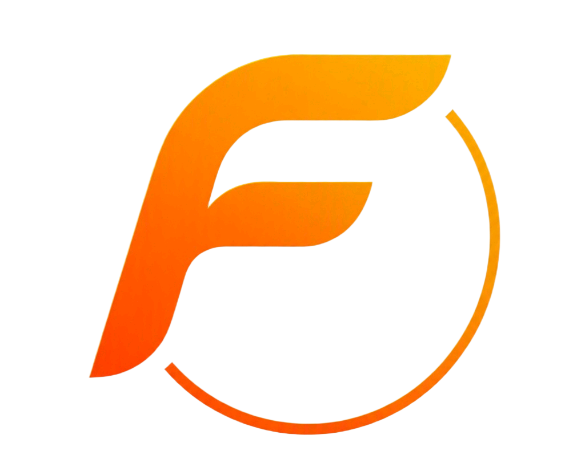

# Flariox OS

Flariox OS es una distribución Linux diseñada para ofrecer un entorno moderno, ágil y productivo tanto para desarrolladores como para usuarios avanzados. Su objetivo es combinar un rendimiento optimizado con una experiencia visual agradable y herramientas esenciales preinstaladas.

## ✨ Características principales

- Entorno de escritorio KDE Plasma personalizado
- Interfaz moderna con transparencia y modo oscuro
- Terminal avanzada con Zsh + Oh My Zsh
- Actualizaciones OTA automáticas y sin interrupciones
- Seguridad reforzada con configuraciones inteligentes
- Excelente compatibilidad de hardware y detección automática

## 🧰 Herramientas incluidas

- Linux Kernel 6.x+
- Git, Node.js, Python3, PHP preinstalados
- Docker, Podman y herramientas de contenedores listas para usar
- Visual Studio Code y editores alternativos
- Navegador web optimizado con extensiones preconfiguradas para privacidad

## ⚙️ Instalación

1. Descarga la ISO desde el sitio oficial o el repositorio de lanzamientos.
2. Graba la imagen en una memoria USB con [balenaEtcher](https://www.balena.io/etcher/) o herramienta similar.
3. Arranca desde el USB e inicia el instalador gráfico.
4. ¡Disfruta de Flariox!

## 🎯 Público objetivo

- Desarrolladores web y de software
- Profesionales creativos
- Usuarios de Linux que desean un sistema pulido y eficiente desde el primer arranque

## 📬 Soporte y comunidad

¿Tienes preguntas o sugerencias? Únete a la comunidad Flariox o abre un issue en el repositorio oficial.

## 🌐 Sitio web

Este repositorio contiene el sitio estático publicado en GitHub Pages para `www.flariox.com`. GitHub Pages sirve HTML, CSS y JavaScript, pero no ejecuta PHP del lado del servidor.

El contacto del sitio utiliza los enlaces `mailto:support@flariox.com`, que abren el cliente de correo del visitante; no hay un formulario de contacto con backend PHP. La mención de PHP en las herramientas de Flariox OS se refiere a la distribución, no al alojamiento de este sitio.

---

**Flariox OS** — Hecho con pasión por el software libre 🚀🐧
