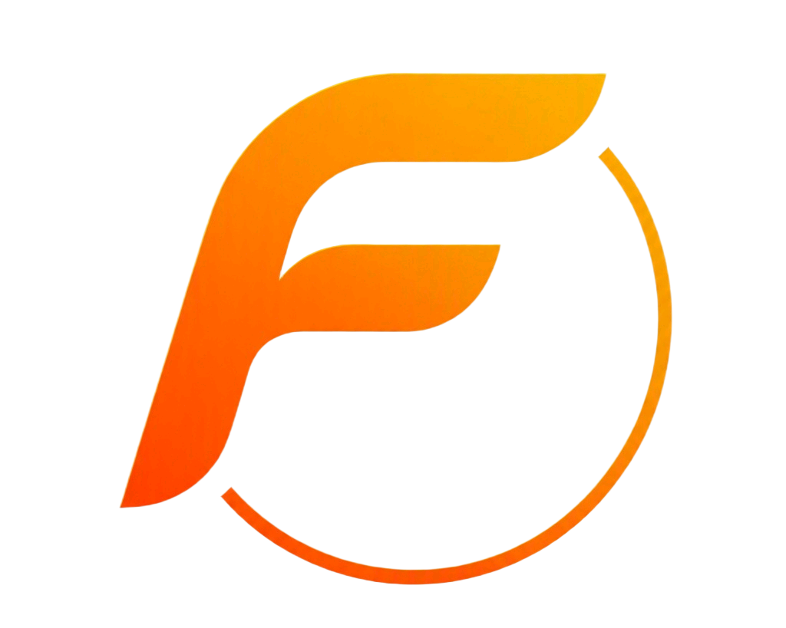

# Flariox OS

Flariox OS es una distribución Linux diseñada para ofrecer un entorno moderno, ágil y productivo tanto para desarrolladores como para usuarios avanzados. Su objetivo es combinar un rendimiento optimizado con una experiencia visual agradable y herramientas esenciales preinstaladas.

Este repositorio contiene el sitio web estático de Flariox: inicio, blog, preguntas frecuentes y una guía avanzada de Arch base. No contiene las fuentes de construcción de las ISO ni los manifiestos de paquetes; las características del sistema descritas abajo no se verifican desde este sitio.



## ✨ Características principales

- Entorno de escritorio KDE Plasma personalizado
- Interfaz moderna con transparencia y modo oscuro
- Terminal avanzada con Zsh + Oh My Zsh
- Actualizaciones OTA automáticas y sin interrupciones
- Seguridad reforzada con configuraciones inteligentes
- Excelente compatibilidad de hardware y detección automática

## 🧰 Herramientas incluidas

- Linux Kernel 6.x+
- Git, Node.js, Python3, PHP preinstalados
- Docker, Podman y herramientas de contenedores listas para usar
- Visual Studio Code y editores alternativos
- Navegador web optimizado con extensiones preconfiguradas para privacidad

## ⚙️ Instalación

Las descargas de Standard y Minimal están enlazadas en [el sitio](https://www.flariox.com/#download). Todavía no se han publicado sumas SHA-256 ni firmas para estas imágenes, y las instrucciones específicas de sus instaladores están pendientes.

La [guía incluida](./install.html) es una referencia avanzada de instalación manual de Arch Linux base para x86_64 y UEFI. No instala el escritorio ni las personalizaciones de Flariox OS.

## Desarrollo y verificación del sitio

Requiere Node.js 22 o posterior. Desde la raíz del repositorio:

```sh
npm ci --ignore-scripts
npm run vendor
npm run check
npx playwright install chromium
npm test
npm run audit:dependencies
npm run serve
```

Abre [http://127.0.0.1:4173](http://127.0.0.1:4173). El sitio no necesita compilación: los archivos HTML, CSS, artículos y dependencias del navegador en `assets/vendor/` se publican directamente. Los archivos de dependencias distribuidos con el sitio deben permanecer versionados.

Para actualizar una dependencia, instala una versión exacta con `npm install --save-exact paquete@version` (o `--save-dev --save-exact` para herramientas de desarrollo), ejecuta `npm run vendor` y repite las verificaciones anteriores. Revisa y versiona juntos el manifiesto, el archivo de bloqueo y los archivos generados; el análisis de dependencias no verifica el contenido de las ISO.

## Publicación y pendientes

GitHub Pages sirve este sitio estático y no ejecuta PHP. No hay un backend de contacto ni de suscripción; el formulario de boletín sigue oculto. La edición Developer, las capturas y los enlaces pendientes también permanecen ocultos hasta estar completos.

Quedan pendientes la documentación real de los instaladores de Flariox y los hashes y firmas publicados por quienes mantienen las ISO. Los encabezados de seguridad HTTP y las redirecciones dependen del alojamiento; una configuración de servidor o proxy debe verificarse después del despliegue. Las etiquetas HTML no sustituyen todos los encabezados, como `frame-ancestors` o HSTS.

## 🎯 Público objetivo

- Desarrolladores web y de software
- Profesionales creativos
- Usuarios de Linux que desean un sistema pulido y eficiente desde el primer arranque

## 📬 Soporte y comunidad

¿Tienes preguntas o sugerencias? Únete a la comunidad Flariox o abre un issue en el repositorio oficial.

---

**Flariox OS** — Hecho con pasión por el software libre 🚀🐧
